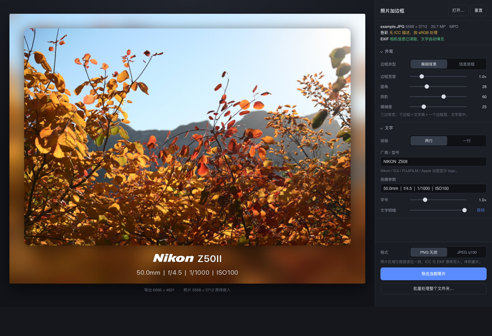
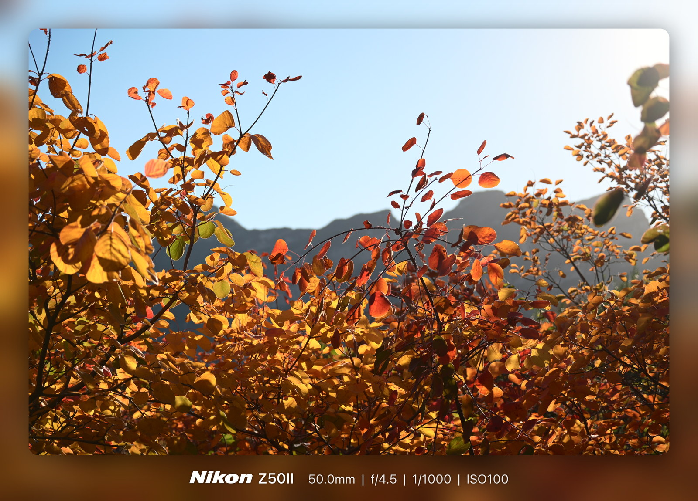
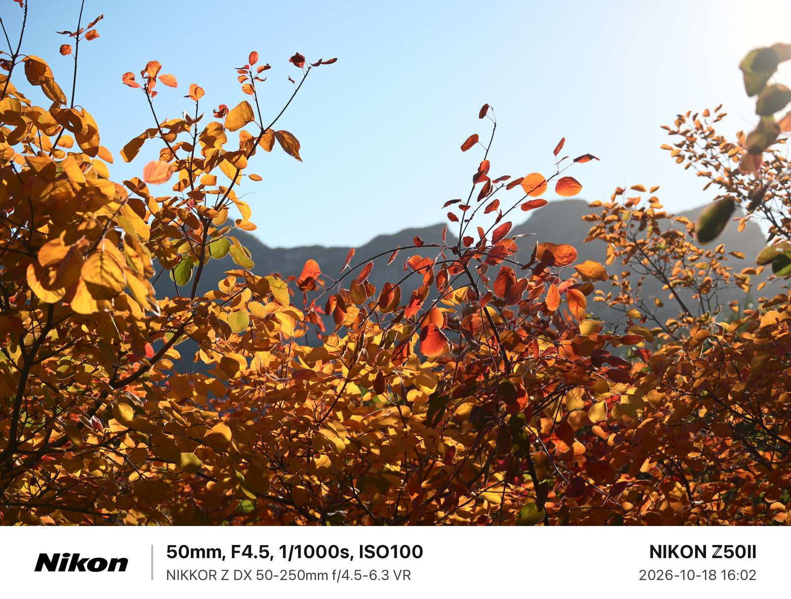

<!-- SPDX-FileCopyrightText: 2026 QuincyLeo -->
<!-- SPDX-License-Identifier: GPL-3.0-or-later -->
# photo-framer

English · [简体中文](README.md)

Add a clean frame with shooting information to your photos. The app provides live preview, single-photo export, and folder batch processing.



## Features

- **Blurred backdrop**: extends the photo with a blurred background and places the maker, model, and shooting settings below it.
- **Info bar**: adds a white or black bar below the photo for exposure settings, lens, camera model, and date and time.
- **Automatic captions**: reads shooting information from EXIF and lets you edit every field. Nikon, DJI, FUJIFILM, and Apple can be shown as maker logos.
- **Flexible export**: export as PNG or JPEG. The photo keeps its original composition without scaling or cropping.






## Usage

### Start

Python 3 is required. The launch script installs Pillow if it is missing.
The interface is currently in Chinese; labels below use the text shown in the app.

```bash
cd photo-framer
./start.command
```

To open a specific photo on launch:

```bash
./start.command photo.jpg
```

The browser opens the local interface automatically. Close the terminal to exit. You can also run:

```bash
python3 server.py
```

### Workflow

1. Drag a photo into the window, or click `打开…` (Open…) to choose one.
2. Choose a frame style under `外观` (Appearance) and adjust the frame, corner radius, shadow, blur, or colour.
3. Edit the layout, type size, and caption under `文字` (Text). Captions follow EXIF by default and can be edited field by field.
4. Choose PNG or JPEG, then click `导出当前照片` (Export current photo).

Settings are retained between launches. Click `重置` (Reset) to restore the defaults.

Single-photo exports go to the browser's default download folder as `<original>_framed.png` or `<original>_framed.jpg`.

`批量处理整个文件夹…` (Batch process folder) processes the images in a folder with the current settings and writes the results to a `framed/` directory inside it. Existing files are not overwritten.

Shortcuts: `⌘O` opens a photo and `⌘S` exports the current photo.

## Formats and platforms

Common JPEG, PNG, TIFF, WebP, and AVIF files are supported. HEIC/HEIF requires one additional package:

```bash
python3 -m pip install --user pillow-heif
```

The file picker and batch processing use macOS native dialogs. On other platforms, you can open a single photo by dragging it into the window; those two features are currently unavailable.

Photos without EXIF do not have shooting information to fill automatically, but you can enter it under `文字` (Text).

## Licence

[GPL-3.0-or-later](LICENSE)
