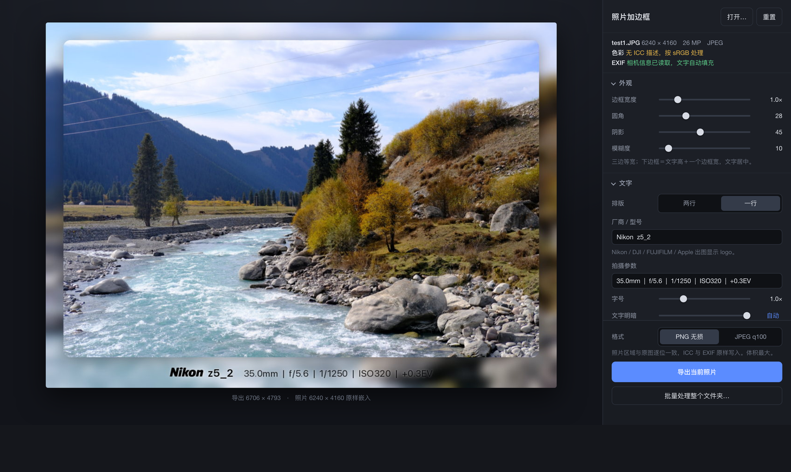
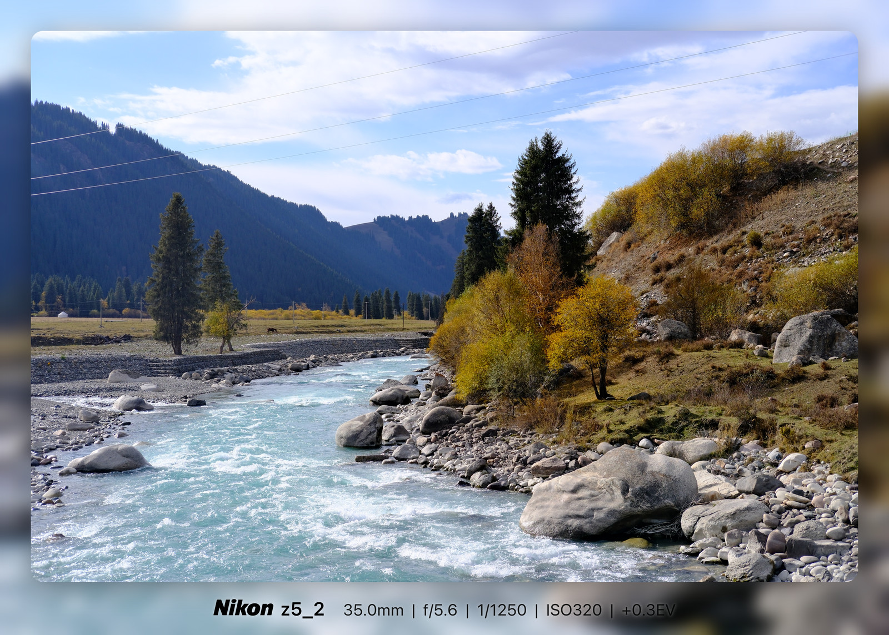
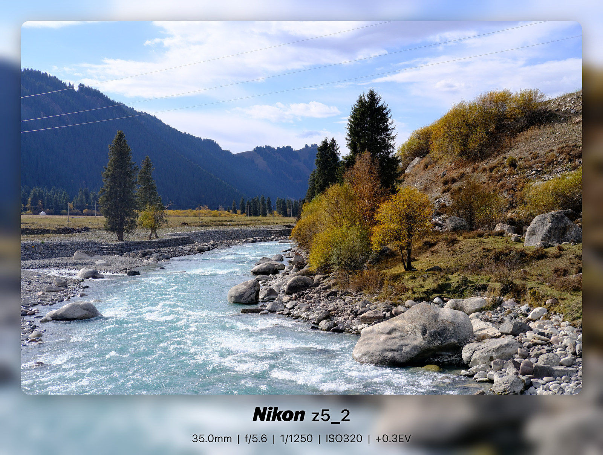

<!-- SPDX-FileCopyrightText: 2026 QuincyLeo -->
<!-- SPDX-License-Identifier: GPL-3.0-or-later -->
# photo-framer

English · [简体中文](README.md)

Wrap a photo in a good-looking frame that carries its shooting data. The
photo itself comes out completely untouched.



Six fine-tuning sliders: border width, corner radius, shadow, blur, type
size, text lightness.

The caption is fixed in shape — maker and model, plus the exposure settings
— and can be shown on one line or two. The maker names of Nikon, DJI,
FUJIFILM and Apple print as a vector logo. The photo's pixels, its colour
profile and its EXIF all survive as they were.

Results, one-line and two-line (the images shown in this README are scaled
down):





## Running it

```bash
cd photo-framer
./start.command              # or: python3 server.py
./start.command photo.jpg    # open a specific photo straight away
```

Your browser opens on `http://127.0.0.1:8787/?t=…`. Closing the terminal
shuts it down.

Pillow (≥ 10) is the only dependency; `start.command` installs it if it is
missing. The font paths and the native file picker are macOS-specific — on
another platform you will need to change the font constants at the top of
`framer.py` and `native_pick()` in `server.py`.

The interface itself is in Chinese only; where this document names a button
it gives the label followed by an English gloss.

The browser previews a JPEG proxy with a 1024 px long edge (about 40 ms, so
the sliders keep up). Every export is re-rendered from the original file on
disk.

## Known limits

- **16-bit TIFFs get truncated to 8-bit.** Pillow drops the low byte when it
  reads 16 bit/channel TIFFs; that is an upstream limitation. The info bar
  warns you in yellow. 8-bit JPEG/PNG/WebP are unaffected.
- **HEIC/HEIF needs one extra package**: `pip3 install --user pillow-heif`.
  Restart and it is recognised; without it you get a clear message rather
  than a crash.
- **A photo with no ICC profile** is treated as sRGB, and no profile is
  written to the output either. The info bar says so.
- **A photo whose EXIF has been stripped** — plenty of editing apps and
  sharing pipelines delete Make/Model/aperture/shutter — gets an empty
  caption. The info bar warns you in yellow; type it in yourself.
- The frame, caption and shadow colours are written directly in the photo's
  own numeric space. If the photo is Display P3, white is P3 white.

## Controls

Six sliders, plus the caption text and a layout switch. The finer
proportions are already tuned by eye and are not exposed.

| Control | Range | Notes |
|---|---|---|
| Border width | 0.1 – 5.0 ×, step 0.1 | 1.0 is the tuned base width (5.6% of the short edge) |
| Corner radius | 0 – 100 | 0 is square |
| Shadow | 0 – 100 | 0 is no shadow; opacity and spread move together |
| Blur | 3 – 100, default 10 | Gaussian; the dial × 0.12% is the radius as a share of the short edge |
| Type size | 0.5 – 2.5 × | scales both lines; 1.0 is the tuned base size |
| Text lightness | 0 – 100, or automatic | see below |

Settings persist in localStorage, so they are still there next time.
`重置` (Reset) restores the defaults.

### The frame

Left, right and top are all the same width. The bottom band is the caption
height plus one border width, and that one border width is split evenly
above and below the text — so **the caption sits vertically centred in the
bottom band, and the whitespace above and below it adds up to exactly one
border width**.

Raise the type size, or switch from two lines to one, and the bottom band
follows automatically. Nothing to adjust by hand.

Every length above is derived from the photo's own dimensions.

### Background blur

The backdrop is the photo itself, scaled up 1.15× and centre-cropped, under
a **Gaussian blur**. The dial × 0.12% is the Gaussian radius as a share of
the photo's short edge — the default of 10 means 1.2% (about 33 px on a
3450 × 2760 photo), and the floor of 3 means 0.36%.

## The caption

Two fixed groups: **maker  model** (two spaces between them), and
**focal | aperture | shutter | ISO**, pipe separated. A non-zero exposure
compensation adds `+0.3EV` on the end; a zero one is left out. One line by
default, two if you prefer:

```
One line (default)  NIKON  z5_2    35.0mm | f/5.6 | 1/1250 | ISO320 | +0.3EV

Two lines               NIKON  z5_2
          35.0mm | f/5.6 | 1/1250 | ISO320 | +0.3EV
```

Maker and model are printed **exactly as the EXIF spells them**, with no
case folding: `Nikon` stays `Nikon`, `FUJIFILM` stays `FUJIFILM`. Only two
things are cleaned up — the corporate suffix some makers append
(`NIKON CORPORATION` → `NIKON`) and the brand prefix cameras repeat in the
model field (`FUJIFILM X-T5` → `X-T5`). Four makers get a logo instead of
their name; see below.

### Maker logos

For Nikon, DJI, FUJIFILM and Apple, the maker's name in the title is
replaced by the maker's logo. Every other maker keeps printing as text.

The logos are **vector** (SVGs in `assets/logos/`), filled at whatever pixel
height the caption asks for at the moment of rendering. Size and position
follow the typography:

- Height = **1.2 × the cap height** of the model name beside it
  (`framer.MARK_HEIGHT`).
- Logo and type are drawn into the same mask, so **lightness, alpha and the
  counter-shaded halo all follow the caption** — black type on a bright
  backdrop means a black logo too.

> Note: each brand has explicit rules about the colour and the context in
> which its logo may be used. This project uses them only to label a photo's
> shooting data, non-profit and non-commercial.

**Which maker** is settled by `framer.resolve_mark()`, EXIF first:

1. The EXIF `Make` field, tidied the way the caption tidies it
   (`NIKON CORPORATION` → `NIKON`).
2. If `Make` is empty, the `Model` field. Nikon and Canon repeat the brand
   inside `Model` (`NIKON D850`).

To add a maker logo, add a line to `MARKS` in `logos.py` — an SVG file name
and the two alignment numbers.

### Type size

Type size = the photo's short edge × a percentage × the size multiplier. It
is never a fixed pixel value. One-line and two-line layouts each have their
own tuned proportions:

| | Title | Settings |
|---|---|---|
| One line (default) | short edge × 3.38% | short edge × 2.93% |
| Two lines | short edge × 4.42% | short edge × 2.86% |

In actual pixels (one line, size 1.0×):

| Short edge | Title | Settings |
|---|---|---|
| 2000 px | 68 px | 59 px |
| 4160 px | 141 px | 122 px |
| 6000 px | 203 px | 176 px |

### Chinese text

SF Pro carries no CJK glyphs, so Chinese typed into the caption would come
out as a row of placeholder boxes. The tool checks each character against the
primary face (by rendering it and comparing against a code point no font
defines) and falls back to Hiragino Sans GB for the ones it lacks — W3 and
W6 standing in for regular and semibold. Mixed Latin and Chinese share a
single baseline.

### Letter spacing

A uniform 0.03em. Pillow has no tracking parameter, so glyphs are placed one
at a time; for pure Latin text each position still comes from `getlength` of
the preceding substring, which keeps the font's own kerning intact.

### Text lightness

Automatic by default: it samples the mean brightness of the backdrop
directly under the caption and picks **pure white** over a dark one, **pure
black** over a bright one (the threshold is luma 0.55). Behind the text sits
a soft counter-shade — dark behind white type, light behind black — so the
caption stays legible over a busy blurred backdrop.

Drag the slider and you take manual control, anywhere in between; click
`自动` (Auto) on the right to hand it back. In automatic mode the slider
parks at whichever end it chose, so you can see what it decided.

## Where the output goes

**A single export is handed to the browser's downloader** and lands in
whatever folder your browser uses for downloads. The file is named
`<original>_framed.png`.

What crosses to the browser is the finished byte stream, and a `Blob`
download is a byte-for-byte copy — nothing along the way re-encodes the
image.

**Batch** is the only path that writes to disk: output goes to `framed/`
inside the folder you picked, and a name collision gets a `-2`, `-3` suffix
rather than overwriting anything.

## Batch

`批量处理整个文件夹…` (Batch a whole folder) runs the current settings over
every image in a directory. The confirmation dialog lists the source, the
destination and the format, and spells out whether the caption is following
each photo's EXIF or using the text you typed. ICC and EXIF are preserved
per photo. You can cancel mid-run.

## Keyboard

`⌘O` open a photo · `⌘S` export the current one · you can also drop a photo
onto the window

## Tests

```bash
python3 tests/test_lossless.py   # renderer: bit-exactness, frame rule, EXIF/EV, tracking, CJK fallback, maker logos, auto colour, extreme settings
python3 tests/test_server.py     # HTTP layer: auth, preview, download-style export, batch, keep-alive framing
```

`test_lossless.py` works on a high-frequency noise pattern, where any
resampling shows up immediately. The frame rule (whitespace above + below
the caption == one border width), the blur floor, zero EV being omitted,
automatic colour only ever choosing pure black or pure white, type size
scaling proportionally, and Chinese falling back to a second face are all
guarded by assertions. Neither script needs any external asset; they
generate their own images.

## Files

| | |
|---|---|
| `framer.py` | the renderer. Pure Pillow, importable on its own from a script |
| `logos.py` | the maker logos: SVG path parsing and on-demand filling, Pillow only as well |
| `server.py` | the local HTTP service. Binds 127.0.0.1 only; every `/api/` call checks a single-run token |
| `static/` | the interface |
| `assets/logos/` | the four makers' logos, as vectors |
| `assets/` | the screenshot and example output used by the README |

`framer.py` works directly as a library:

```python
import framer
framer.render_file("a.jpg", framer.Params(border=1.5, radius=40, one_line=True), "png")
```

## Security

The service binds `127.0.0.1` only, mints a single-run token at startup, and
checks both `Host` and `Origin`, so no other page in your browser can drive
it. It can, though, read and write anywhere your user account can — that is
how the file pickers work. Treat it as a local tool and do not expose the
port.

A photo dropped onto the window is copied into `.temp/` inside the checkout
rather than a system temp directory, so the cache cannot scatter somewhere
you are not looking. Files older than a day are swept at startup, and
`.gitignore` keeps the directory out of commits. To clear it completely,
`rm -rf .temp`.

## Licence

GNU General Public License v3.0 or later. The full terms are in
[LICENSE](LICENSE) — the text from gnu.org, unmodified.

One exception: the four SVGs in `assets/logos/` come from
[Simple Icons](https://simpleicons.org) and are CC0-1.0 (each file's
provenance is in the `.license` beside it). The logos themselves are the
trademarks of their owners and appear here only to name the camera that took
the photo.

```
Copyright (C) 2026 QuincyLeo

This program is free software: you can redistribute it and/or modify
it under the terms of the GNU General Public License as published by
the Free Software Foundation, either version 3 of the License, or
(at your option) any later version.

This program is distributed in the hope that it will be useful,
but WITHOUT ANY WARRANTY; without even the implied warranty of
MERCHANTABILITY or FITNESS FOR A PARTICULAR PURPOSE.  See the
GNU General Public License for more details.

You should have received a copy of the GNU General Public License
along with this program.  If not, see <https://www.gnu.org/licenses/>.
```
